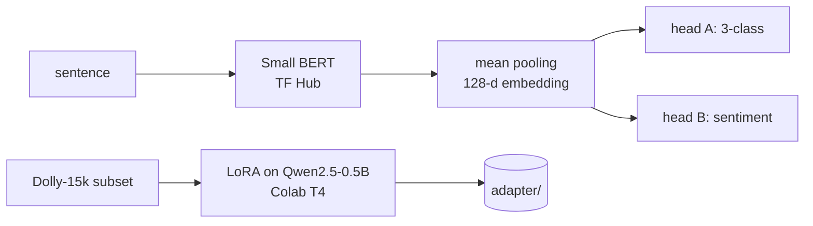

# Sentence Transformers, Multi-Task Learning & LLM Fine-Tuning

[](https://github.com/Deshraj-Jogiya/sentence-transformers-llm-finetuning/actions/workflows/ci.yml) 

Three connected pieces of transformer work: a Sentence Transformer built on a Small BERT backbone, a multi-task extension with
classification and sentiment heads, and LoRA fine-tuning of a modern generative LLM on a free GPU.

## Highlights

- **Sentence Transformer:** Small BERT from TensorFlow Hub, mean-pooled into 128-dimensional sentence embeddings.
- **Multi-task learning:** two heads on the shared backbone (3-class sentence classification, 2-class sentiment), each with its own
  softmax output; per-task loss and accuracy logged during a training run on synthetic text.
- **Transfer-learning plan:** full model vs backbone-only vs single-head freezing compared, with a staged fine-tuning recommendation.
- **LoRA fine-tuning:** Qwen2.5-0.5B-Instruct on a 600-example Databricks Dolly-15k subset (540/60 split) on a free Colab T4 GPU. Loss
  fell over 3 epochs (1.779 → 1.760 → 1.650). With greedy decoding the adapter changed 1 of 5 held-out answers: a clear improvement on an
  open-ended prompt, identical output on four short factual ones. The test asserts exactly that.

## Architecture



## Stack

TensorFlow, TensorFlow Hub, TensorFlow Text, NumPy, PyTorch, Hugging Face Transformers, PEFT (LoRA), pytest, GitHub Actions.

## Run it

```bash
pip install -r requirements.txt
python main.py                        # Sentence Transformer inference
python models/multitask_model.py
python models/train_multitask.py

pip install -r finetuning/requirements.txt
python -m unittest tests.test_finetuned_adapter -v   # base model + committed adapter
```

`finetuning/train_lora.py` is the training script (run on a Colab T4), `finetuning/compare.py` produces
`finetuning/comparison_results.json`, and `reports/task3_training_notes.md` covers the freezing strategy.
